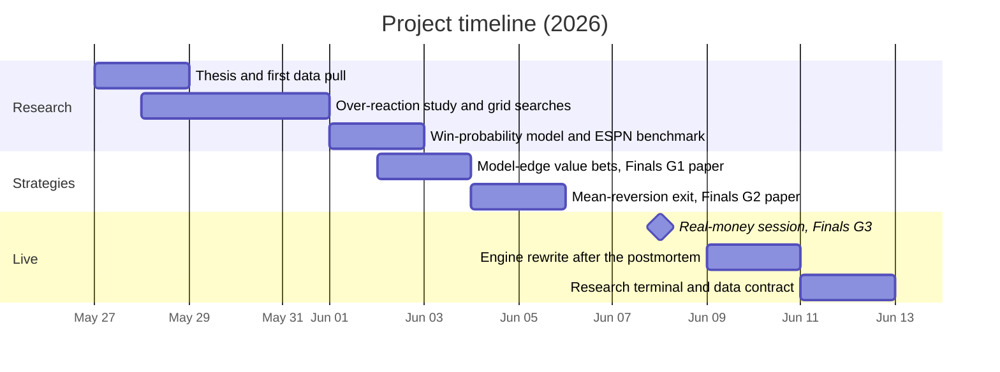
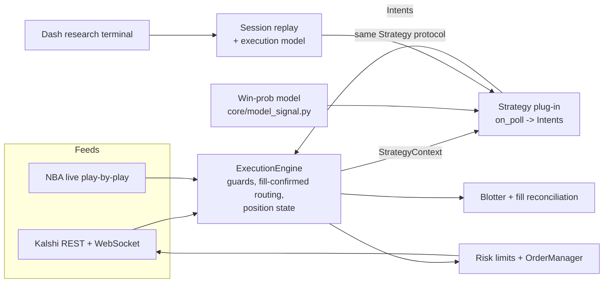
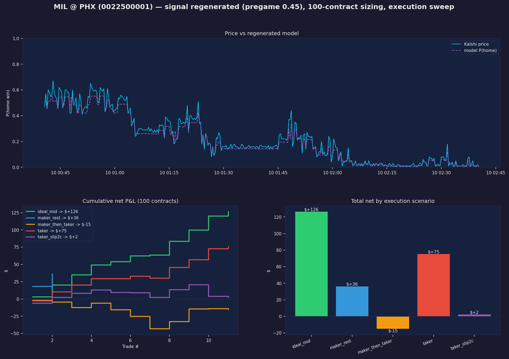

# NBA Prediction Market Engine

An event-driven research and execution system for Kalshi's in-game NBA win markets. One strategy interface runs three places: live trading, historical replay under different execution models, and a Dash research terminal.

> **About this repo.** This is a curated extract of a private research project. The proprietary win-probability model, the tuned strategy parameters and the recorded market data are **not** included. In their place, the public build ships a closed-form baseline model, illustrative parameters and a synthetic game generator, so everything here runs end to end without credentials.

## Timeline

The project went from an idea to real-money trading in 12 days. The live session then forced a rebuild of the execution layer.



| Phase | What happened |
| --- | --- |
| Research | Found that in-game prices over-react to single scoring plays and revert fast (median under 30 seconds). Built a fee-aware backtester and grid-searched entry and exit filters. |
| Modeling | Trained win-probability models on several seasons of play-by-play and benchmarked them against ESPN's live win probability, scored only on plays where the game was in doubt. |
| Strategies | Traded the gap between the model and the market, first held to settlement and then with a mean-reversion exit state machine. Paper-traded NBA Finals games 1 and 2. |
| Live | Traded real money in Finals game 3. The session exposed five execution bugs (below), which drove a rewrite into the engine in this repo. |
| Tooling | Built the replay harness, the execution-model sweep, the research terminal and a canonical data contract. |

## Quickstart

```bash
pip install -r requirements.txt
python scripts/make_sample_data.py              # 6 synthetic games -> sample_data/
python live-execution/backtest/session_replay.py  # replay one game under 5 execution models
python live-execution/run_terminal.py           # research terminal on http://127.0.0.1:8050
```

Tests (no network, no credentials):

```bash
python live-execution/test_engine.py            # engine guards and fill-confirmed round trips
python live-execution/backtest/test_exec_model.py
python live-execution/test_dashboard.py         # catalog, replay cache, figures, app build
```

## Architecture



- **Strategies are pure decision layers.** A strategy gets a read-only `StrategyContext` each poll and returns `Intent`s. It never touches orders or the exchange, so the same class runs live, in replay and in the terminal ([`core/interfaces.py`](live-execution/core/interfaces.py)).
- **The engine owns everything stateful** ([`execution/engine.py`](live-execution/execution/engine.py)): the poll loop, stale-clock, game-over and market-closed guards, an order-failure halt, routing that only books a position once a fill is confirmed, and pregame-probability persistence across restarts.
- **Execution is a parameter of the backtest** ([`backtest/exec_model.py`](live-execution/backtest/exec_model.py)). The same recorded game is scored as mid, taker, taker with slippage, resting maker, or maker-then-taker. Maker fills are modeled with adverse selection: a resting order fills only if the tape later trades through its price.
- **Risk is on by default** ([`execution/risk.py`](live-execution/execution/risk.py)): `dry_run=True`, per-order, per-market, exposure and daily-loss limits, plus a kill switch.
- **One data contract** ([`game_data.py`](game_data.py)): ns-UTC timestamps, YES-frame dollar prices and integer contracts, enforced at every read and write.

## Example replay (synthetic data)



The same strategy on the same game nets anywhere from +$126 to -$15 depending only on how orders fill. *The game and prices are synthetic; the numbers show how the harness works, not real performance.*

## What the research found

- **Execution decided the P&L more than the model.** Every frictionless backtest overstated the edge. Under realistic taker fills, a 10-game replay sweep on real data was net negative. Only resting (maker) fills leave room for an edge, which matches the fee schedule: taker fees run up to about 4x maker fees per contract.
- **Separate signal quality from execution quality.** Re-scoring the same intended trades under different fill models was the single most useful research tool.
- **Data volume was the binding constraint.** Kalshi's historical trade API ended partway through the season, so the project recorded its own tick data over WebSocket to grow the replayable set.
- **A one-line data bug can fake an edge.** Microsecond vs nanosecond timestamps between two data sources silently froze the backtester's price lookup on the settlement price. That is why `game_data.py` normalizes everything at the I/O boundary.

### Live-session postmortem

The real-money session ended up, but by luck: the realized P&L came from an accidental position, not the strategy. The root causes, each now guarded in the engine:

| # | Failure | Fix |
| --- | --- | --- |
| 1 | NO orders were priced with an unconverted YES price | Every order price is YES-frame; conversion happens once, when building the payload ([`order_manager.py`](live-execution/execution/order_manager.py)) |
| 2 | The portfolio tracker read stale API field names, so risk saw an empty book | The tracker parses both payload shapes ([`tracker.py`](live-execution/portfolio/tracker.py)) |
| 3 | After a restart, the pregame prior was taken from the in-game price | The pregame probability is persisted per game; a `--pregame` override covers restarts |
| 4 | No fill confirmation, so logged P&L included phantom fills | Positions open and close only on confirmed fills; [`reconcile_fills.py`](live-execution/blotter/reconcile_fills.py) audits P&L against exchange fills |
| 5 | No game-over or stale-clock guards | The engine blocks entries on a frozen clock and flattens and halts at the final buzzer |

The strategy also has a **persistent-edge governor**: if the model disagrees with the market for 15 minutes without converging, it assumes a model input is wrong and stops entering ([`strategy/model_edge.py`](live-execution/strategy/model_edge.py)).

## Repo layout

| Path | Contents |
| --- | --- |
| `live-execution/execution/` | `ExecutionEngine`, order manager, risk limits |
| `live-execution/strategy/` | `ModelEdgeStrategy` example, strategy registry, illustrative parameters |
| `live-execution/core/` | Shared interfaces, Kalshi client, NBA feed, fee model, baseline win-probability model |
| `live-execution/backtest/` | Session replay and the execution model |
| `live-execution/portfolio/`, `blotter/` | Position tracking, session event log, fill reconciliation |
| `live-execution/dashboard/` | Dash workspace: live widgets plus Signal Explorer and Alpha Scanner over archived games |
| `live-execution/feeds/` | WebSocket tick collector |
| `live-execution/run.py` | Game-day launcher (dry run unless `--live`) |
| `game_data.py`, `kalshi_auth.py` | Data contract and validation; Kalshi RSA-PSS request signing |
| `scripts/make_sample_data.py` | Synthetic games in the same layout as the real archive |
| `docs/DESIGN.md` | The original build spec |

## Using real data

Point `NBA_DATA_DIR` at an archive with the same layout as `sample_data/` (`kalshi/ticks/`, `cache/s3_pbp/`, `kalshi/markets/kalshi_nba_mapping.parquet`). For live trading, copy `.env.example` to `.env` with your Kalshi API credentials and set `TERMINAL_LIVE=1` for the terminal. Orders are only sent with `run.py --live`, after a typed confirmation.

*Not investment advice. This is a research project; use the live path at your own risk.*
